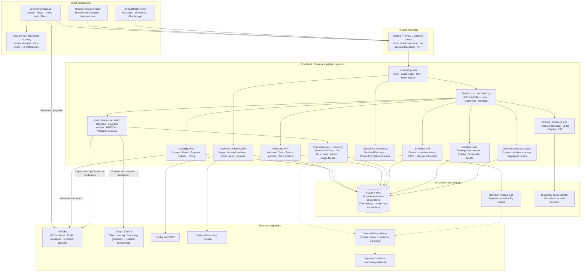
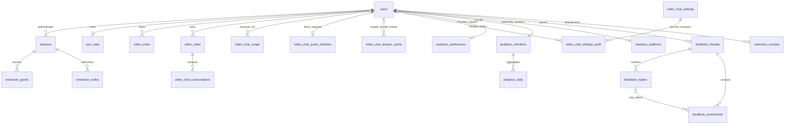
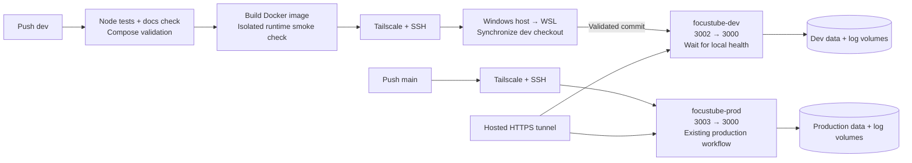

# FocusTube Architecture

Reviewed **2026-11-25** against the source prepared for `dev`. [Open the interactive Architecture Atlas](diagrams/index.html): the system overview, module/storage map and chat-budget flow cover the platform from browser to provider and persistent storage. [Source fingerprints](diagrams/source-inventory.json) bind this review to file contents; they do not describe the private configuration of a running deployment.

## System Shape

FocusTube is a same-origin, self-hosted web application: vanilla browser JavaScript and an optional Manifest V3 extension talk to one Express/Node process. SQLite is the durable store. The application does not require a frontend build server, a separate authentication service, Redis, a message broker, or a vector database.

Start with the [system map](diagrams/system.html), then open [platform modules and storage](diagrams/services.html). This full-platform view also renders directly on GitHub:



Arrows show logical calls or data movement. Feature handlers share a process and database; boxes are not separate microservices. Playback travels directly between the browser and YouTube. SMTP, CAPTCHA, Gemini, the extension and exported telemetry depend on configuration and authorization. The basic Docker image omits the optional media-download tools.

| Architecture view | Main question |
| --- | --- |
| [System map](diagrams/system.html) | What runs in the browser, application, data store and external services? |
| [Modules and storage](diagrams/services.html) | Which code owns each feature, and what persists? |
| [Chat budget and cache accounting](diagrams/chat-budget.html) | Where are request slots and money reserved, rejected and settled? |
| [Deployment](diagrams/deployment.html) | How does `dev` validation gate the hosted update? |
| [Feature flows](diagrams/index.html#account) | How do invitations, learning, notes, capture and feedback recover from errors? |

## Repository Structure

| Surface | Files | Responsibility |
| --- | --- | --- |
| HTTP composition | [server.js](../server.js) | Security middleware, static/vendor assets, route mounting, metadata/search, notebook/profile/statistics APIs, health and shutdown |
| Identity | [auth.js](../auth.js), [auth-services.js](../auth-services.js) | Session cookies, password verification, registration, email proof, profile/password changes, admin invitation routes, SMTP and CAPTCHA adapters |
| Core persistence | [db.js](../db.js) | Additive schema setup, ownership queries, immediate transactions, profile/note revisions, activity, invitations, forum and cleanup |
| Learning shell | [public/index.html](../public/index.html), [public/app.js](../public/app.js), [public/styles.css](../public/styles.css) | Hash routing, Library, course player, plans, dashboard, contextual navigation, Settings and account guards |
| Early browser setup | [public/auth-entry.js](../public/auth-entry.js), [public/theme.js](../public/theme.js) | Scrub invitation fragments before application scripts; restore appearance without exposing secrets |
| Notes | [public/notebook-model.js](../public/notebook-model.js), [public/notebook-editor.js](../public/notebook-editor.js), [public/notebooks.js](../public/notebooks.js) | Validated versioned documents, source anchors, Quill integration, draft recovery, autosave/conflicts, append, Markdown and print |
| Ask | [video-chat.js](../video-chat.js), [video-chat-store.js](../video-chat-store.js), [public/video-chat.js](../public/video-chat.js) | Caption acquisition, bounded source context, Gemini streaming, usage reservation, conversations, validation and explicit note proposals |
| Chat administration | [public/video-chat-admin.js](../public/video-chat-admin.js), [video-chat.js](../video-chat.js), [video-chat-store.js](../video-chat-store.js) | Persistent monthly USD cap, pause/cache controls, spending classifications, revision checks and audit history |
| Product analytics | [analytics.js](../analytics.js), [analytics-store.js](../analytics-store.js), [public/analytics.js](../public/analytics.js) | Member consent, enrollment, audience survey, daily aggregates, retention and administrator reports |
| Feedback | [feedback.js](../feedback.js), [public/feedback.html](../public/feedback.html), [public/feedback.js](../public/feedback.js) | Separate public/private forum page, replies, screenshot normalization/access and moderation; storage lives in the core DB module |
| Invitations UI | [public/invitations.js](../public/invitations.js) | Copy-once links, status filtering, cursor paging, guarded expiry edits and revocation |
| Capture API | [extension.js](../extension.js), [extension-store.js](../extension-store.js), [public/extension-connect.js](../public/extension-connect.js) | Exact destination/extension identity, cookie-first access, PKCE consent/grants, additive save receipts and revocation |
| Browser extension | [extension/manifest.json](../extension/manifest.json), [extension/service-worker.js](../extension/service-worker.js), [extension/popup.js](../extension/popup.js) | Optional permissions, environment selection, supported-video detection, bounded pending queue and user-confirmed saves |
| Search and downloads | [youtube-search.js](../youtube-search.js), [downloads.js](../downloads.js) | Search normalization; optional authorized media jobs using external tools, not an ordinary player dependency |
| Operations | [observability.js](../observability.js), [compose.monitoring.yaml](../compose.monitoring.yaml), [ops/monitoring/config.alloy](../ops/monitoring/config.alloy) | Bounded logs/metrics, private scrapes and opt-in collector export |
| Tooling | [scripts/auth-admin.js](../scripts/auth-admin.js), [scripts/check-runtime.js](../scripts/check-runtime.js), [scripts/package-extension.js](../scripts/package-extension.js), [scripts/update-timeline.js](../scripts/update-timeline.js), [scripts/update-architecture.js](../scripts/update-architecture.js) | Bootstrap/capacity, isolated runtime smoke check, extension packaging, history and architecture generation |

Dependencies and exact installed versions are owned by [package.json](../package.json) and [package-lock.json](../package-lock.json). Important libraries include Express, better-sqlite3, Quill, Nodemailer, Sharp, the official Google Gen AI SDK, the bounded streaming JSON parser, subtitle parsing, and public-caption retrieval. Local fonts and Lucide icons are served through vendor routes.

## Request Boundaries

The server applies monitoring, the independent internal-metrics guard, allowed Host validation and browser security headers. Ordinary `/api` requests then validate the approved web origin; mutations require exact Origin, including scheme and port. Only enumerated extension POST/preflight paths have a narrow extension-origin exception. Body parsers have per-feature limits before the generic parser. Authentication resolves the current session and active account before feature-specific authorization.

- `AUTH_PUBLIC_ORIGINS` authorizes a web origin; `ALLOWED_HOSTS` by itself does not. HTTPS trust depends on the actual, correctly configured proxy boundary.
- Sessions are opaque random tokens; only hashes are stored. Cookies are HttpOnly, SameSite=Strict and Secure over HTTPS. There is no browser JWT or password-reset flow.
- `X-Profile-Account` is mandatory on profile GET/PUT. Notebook, chat, forum and invitation clients use their own account-binding headers to reject stale tabs. These headers supplement session authorization; they are never credentials.
- Anonymous access exists for auth status, public forum reads, public metadata endpoints and health under their respective host/origin rules. In particular, playlist/video metadata handlers are not member-only; keyword search is member-only. Public-facing operators still need ingress abuse controls.
- An administrator can manage invitations, view bounded operational metadata and moderate private forum reports. That role does not grant another member's library, notes, chat, export or download access.
- The private metrics endpoint requires its own internal Host, source-IP allowance and bearer token. An administrator's session does not satisfy that guard.

Exact route contracts are in [api.md](api.md). Authentication details and historical migrations remain in [invite-only-auth-spec.md](invite-only-auth-spec.md).

## Data Ownership

SQLite uses WAL, foreign keys and a bounded busy timeout. Core schema changes use guarded additive migrations; transactional operations serialize with `BEGIN IMMEDIATE` through better-sqlite3 where required. Do not mistake a logical module boundary for a separate database.

The four stores declare **35 application tables**: 29 in the core/chat/extension modules and six in [analytics-store.js](../analytics-store.js). The [generated table inventory](diagrams/source-inventory.json) includes all four stores. This excludes SQLite's own internal tables; lazy initialization and legacy migrations can make a live database differ. Analytics collection remains opt-in even when its schema exists.

| Tables | Ownership and purpose |
| --- | --- |
| `users`, `sessions` | Stable identity, credentials and active-account session lookup; user deletion cascades to sessions |
| `auth_workspace`, `invitations` | Member-capacity singleton and nonreused invitation IDs, use counts, expiry, revocation and revision |
| `login_budgets`, `email_verifications` | Persistent action budgets and bounded, invitation/session-bound email proofs |
| `user_data` | One revisioned JSON profile per user: courses, stats, settings and planning workspace; separate notes/chat revision counters |
| `video_notes` | One document per user/course/video, independent revisions and retained deletion markers |
| `activity_log`, `watch_log`, `activity_batches` | Daily active time, per-video watch history and batch deduplication |
| `user_usage`, `usage_days`, `presence_leases`, `auth_audit` | Bounded operational activity, current-presence challenges and successful account-event records |
| `feedback_threads`, `feedback_replies`, `feedback_screenshots` | Shared forum with public/private ownership and moderation; screenshot BLOBs inherit parent access |
| `video_chats`, `video_chat_conversations` | Per-user/course/video shared transcript and generation/revision, plus up to 20 named message histories |
| `video_chat_usage` | Request identity, state, cost reservation and actual/unknown usage; account deletion detaches ownership rather than resetting spending |
| `video_chat_quota_windows` | One account-owned six-hour window start/count; updated atomically with a new usage reservation and excluded from learning imports/exports |
| `video_chat_answer_cache` | Bounded, expiring answers and optional embeddings; private entries bind account/course/source/context/model, shared entries require trusted public source and canonical task |
| `video_chat_settings`, `video_chat_settings_audit` | Instance-wide budget/pause/cache policy, revision and actor; bounded history of administrator changes |
| `extension_receipts`, `extension_codes`, `extension_grants`, `extension_session_revocations` | Additive capture deduplication, hashed short-lived PKCE codes, parent-session grants and replacement/disconnect revocation |
| `analytics_preferences`, `analytics_members`, `analytics_daily` | Consent/exclusion, enrollment milestones and per-member daily counters; collection requires deployment enablement and eligible consent |
| `analytics_audience`, `analytics_coverage`, `analytics_metadata` | Optional audience answers, coverage intervals and collection-start metadata; aggregate reports exclude ineligible accounts |



This is a logical ownership sketch, not an exhaustive column-level SQL schema; the settings-to-audit relationship is a revision association, not a foreign key. Course/video keys refer to application IDs; courses live in profile JSON, not a separate `courses` table. Constraints and additive migrations are owned by [db.js](../db.js), [video-chat-store.js](../video-chat-store.js), [extension-store.js](../extension-store.js) and [analytics-store.js](../analytics-store.js).

## Chat Budget, Quotas and Provider Calls

Open the [interactive budget flow](diagrams/chat-budget.html). The restored administrator feature is **Monitoring → Video Chat → Monthly spending limit (USD)**. Entering `3.00` persists a 300-cent cap for that installation. Daily or weekly USD caps are not implemented. The per-account request limit is separately configurable as `VIDEO_CHAT_REQUESTS_PER_WINDOW` (30 attempts per six hours by default), with an additional five-per-minute burst limit.

The budget is shared by all accounts in one database and resets on the first day of each UTC month. Local/dev/production use independent ledgers: their environment defaults are $5/$1/$4, respectively, until an administrator overrides them. A single API key does not combine those ledgers. Provider pricing is model-specific; `gemini-3.1-flash-lite` remains the default, while an explicitly selected supported 2.5 model has a separate rate and cache identity.

```mermaid
sequenceDiagram
    participant Member as Member browser
    participant API as Video chat API
    participant DB as SQLite policy / quota / ledger
    participant Cache as Bounded SQLite answer cache
    participant Google as Google provider
    Member->>API: Question + consent + account/video/revision + request ID
    API->>API: Validate session, active account, source and input
    API->>DB: Immediate transaction: replay check, limits, request reservation
    alt Rejected before admission
        DB-->>API: Busy, quota, stale revision, pause or budget error
        API-->>Member: Preserve question; no provider dispatch
    else Admitted once
        opt Cache enabled
            API->>Cache: Exact owner/source/context/model lookup
            Cache-->>API: Valid cached answer or miss
        end
        opt A provider stage is needed
            API->>DB: Re-read policy; reserve embedding or generation maximum
            DB-->>API: Headroom reserved, or stop before dispatch
            API->>Google: Permitted stage with timeout and cancellation
            Google-->>API: Bounded result + usage if known
        end
        API->>API: Validate answer, segment IDs and optional note proposal
        API->>DB: Recheck ownership; settle usage and commit final answer
        DB-->>API: Committed conversation and revision
        API-->>Member: Final NDJSON event / JSON; enable citations and note preview
    end
```

- **Before a paid stage:** an immediate SQLite transaction reserves the maximum cost and counts other pending work. Separate processes cannot spend the same remaining headroom. Embedding and generation use one request row and one request slot.
- **After dispatch:** known provider usage replaces the reservation; unknown usage after timeout/cancel remains conservatively charged. Pre-dispatch failures can release unused money, but an admitted attempt still consumes its request slot. An embedding already performed is not refunded when generation is blocked.
- **Cache reuse:** exact hits cost no provider tokens but consume a new request slot. Semantic reuse can incur embedding cost and requires explicit consent plus configured thresholds. Shared entries additionally require verified public captions and a canonical summary/key-ideas task. Imported captions and learning backups cannot create trusted shared entries.
- **Administrator edits:** the API checks the current admin session and account header again when committing; stale revisions return `409`. Lowering a cap below accounted usage exposes the overage and blocks new paid work; it does not rewrite the ledger. Pause/$0 stops new requests. A call already dispatched can settle under its original reservation.
- **Recovery:** a completed request-ID replay does not call the provider or consume another slot. Clearing conversations, signing out, restoring a learning export or restarting does not reset spending. Account deletion detaches usage ownership while preserving the money total.

The dashboard separates known costs, pending reservations, retained unknown costs and legacy accounting; it also distinguishes embeddings from generation. The ledger tracks monetary estimates and request identity, not a configurable raw-token allowance or the provider's final invoice.

## State and Failure Semantics

| State | Durable source | Recovery boundary |
| --- | --- | --- |
| Course progress, layout mode, tasks/roadmaps | Revisioned profile JSON | Account binding and revision checks prevent blind stale replacement; local pending state is not proof of a completed save |
| Note text | Independently revisioned notebook record | Per-account/tab recovery drafts and explicit conflict resolution; Saved requires server acknowledgement |
| Note pane and appearance | Browser preferences | Panel resize/hide does not recreate the editor or change document ownership |
| Search and current route | Browser memory/hash | Stale responses are ignored or aborted; queries are not a stored search history |
| Chat question/provisional text | Browser state until validated completion | Never insert partial output; pre-dispatch preparation failures differ from uncertain dispatched requests |
| Completed chats and provider accounting | Conversation records and usage ledger | Same request ID does not generate twice; stopping/clearing chat is not a refund or ledger reset |
| Admin budget/cache settings | Revisioned SQLite singleton and audit rows | Survive restart; concurrent edits return `409`; environment values only supply defaults |
| Product analytics and survey | Consent-scoped SQLite records | Collection can be disabled; exclusion/withdrawal and retention are separate from operational logs |
| Forum report/reply and images | One SQLite transaction | Same submission ID and payload return the existing result; visibility is checked on every image read |
| Extension pending operation | Trusted extension storage | Bounded manual Retry/Discard; a receipt is required before reporting a save as confirmed |
| Download jobs and traffic graph | Process memory; temporary download files | Not durable queues/history; process restart is a different boundary from a stored learning record |

An operational database backup is not a learning export. Schema-4 learning exports contain profile/planning, notebook documents, transcripts and named completed conversations, plus learning history. They omit passwords, sessions, grants, cost ledgers and shared feedback. Import replaces the current member's learning state after confirmation and revision checks; it does not restore an entire instance.

## Deployment and Operations

| Configuration | Boundary |
| --- | --- |
| Native `npm start` | Node >=22, loopback host by default, port 3000, chosen data directory |
| [compose.yaml](../compose.yaml) | Local project `focustube`, loopback 3002 to container 3000, persistent data and log volumes |
| [compose.dev.yaml](../compose.dev.yaml) | `focustube-dev`, intended HTTPS development origin, loopback host port 3002 and isolated project volumes |
| [compose.prod.yaml](../compose.prod.yaml) | `focustube-prod`, intended production HTTPS origin, loopback host port 3003 and isolated project volumes |
| [compose.monitoring.yaml](../compose.monitoring.yaml) | Opt-in private Alloy network and sanitized metrics/log export, not direct database or Docker-socket access |

Local and development configurations both use host port 3002 and cannot bind it simultaneously on the same host. Different hostnames do not make them share accounts or database state. The checked-in tunnel comments are intended ingress configuration, not proof that a tunnel currently exists.

[Deployment flow](diagrams/deployment.html) describes the checked-in automation. A `dev` push first runs the application tests, offline documentation checks, Compose validation and a Docker build/smoke check on a clean GitHub runner. The smoke container has no external network or provider credentials. Only after validation succeeds does Tailscale/SSH enter the intended Windows/WSL checkout and run Compose with `--wait --wait-timeout 120`. The existing WSL Docker configuration override is preserved. The production workflow still builds/starts directly on `main` pushes; it does not inherit the new dev validation gate. The separate main-branch PR guard accepts only `dev` as its head.



All three Compose healthchecks now call **container loopback `/api/health`**. This checks the Node process and a lightweight `SELECT 1`; it does not prove writable storage, provider availability, mail delivery or public tunnel reachability. Public HTTPS/auth checks are a separate operational check. A still-running unhealthy container is not automatically restarted by `restart: unless-stopped`.

[Draft release gates](diagrams/release-draft.html) remains the broader proposal for populated-copy recovery rehearsal, explicit environment approval, controlled cutover and recorded acceptance. The implemented dev test/health gates do not automate SQLite backups, rollback or user acceptance. Before rollout, follow the [backup/rollback procedure](v1-release.md#rollout-backup-and-rollback), preserve runtime settings and data volumes, and avoid old application writers against migrated chat/invitation data. Docker storage diagnosis and recovery guidance is in [monitoring](monitoring.md#docker-health-and-storage).

## Maintaining the Diagrams

The globally installed skill is **Archify**, publisher [tt-a1i/archify](https://github.com/tt-a1i/archify), packaged version `2.17` from source commit `9e35d2b0b39b155553ba9fcfe0b4f2a5198dd993`. The downloaded package SHA-256 is `d2296515b0091fb8f00580ea9e0b665d91ca5839fde651abe3ecd57a3ca178ec`. It is installed under `~/.copilot/skills/archify`, with its license and notices. FocusTube has no new Archify runtime dependency.

For a new machine, install the same skill revision into the personal skills folder. The publisher also documents `npx skills add tt-a1i/archify -g`; that follows its current upstream state, so review the resulting version before regenerating these artifacts. Set `ARCHIFY_SKILL_DIR` when your installation is elsewhere. The bundled CLI needs Node >=18; FocusTube itself requires >=22.

1. Review the code path and update the owning Markdown guide before changing its chart. Keep current and draft claims distinct. Do not read secrets or populate real user data in diagrams.
2. Edit the corresponding typed JSON in [diagrams/catalog.json](diagrams/catalog.json). Use stable IDs, real relationships and sparse labels. Workflow charts use schema version 2; all charts use showcase quality. Never hand-edit generated HTML.
3. Run `npm run docs:build`. Each HTML is rendered in a temporary directory, receives the embedded [phone toolbar styles](diagrams/viewer.css), and is replaced only after artifact checks pass. The receipts hash the final styled HTML and the stylesheet; the diagram remains standalone. If source code changed, this command fails until the docs/specs have been reviewed and you explicitly use `npm run docs:build -- --refresh-evidence`.
4. Run `npm run docs:check` and `node --test test/architecture.test.js`. The drift check verifies allowlisted source hashes, table declarations, evidence anchors, JSON/HTML byte receipts, the atlas index and local Markdown file links. It is not an automatic understanding of source semantics and cannot prove every sentence remains true.
5. For a desktop authoring session, use `npm run docs:preview -- system` (or another catalog ID). The watcher binds only to loopback and retains the last-good diagram when edits fail validation. It does not connect to the running FocusTube API. Preview uses the raw renderer; stop it after editing and run the build to embed the phone styles and refresh the receipts.
6. After delivery, run `ARCHIFY_UPDATE_CHECK_DISABLED=1 node "$HOME/.copilot/skills/archify/bin/archify.mjs" visual-check docs/diagrams/system.html --json` for each changed chart, then inspect the actual screenshots. Keep deterministic validation, automated browser evidence, and human/image review separate.

[receipts.json](diagrams/receipts.json) binds exact specification and HTML bytes. [source-inventory.json](diagrams/source-inventory.json) records the reviewed working-tree hashes; it intentionally does not claim public Git source links for uncommitted code. Per-diagram `*.visual-check.json` files contain historical browser evidence with artifact hashes; regenerating HTML makes those older checks stale even if the filename is unchanged.

The atlas and diagrams are local documentation, not a new public application route. Their core content is self-contained and network-independent. Trace motion illustrates authored paths; it is not a traffic monitor, performance benchmark or automatic architecture discovery engine. Archify's optional update checker is disabled by the build commands.
